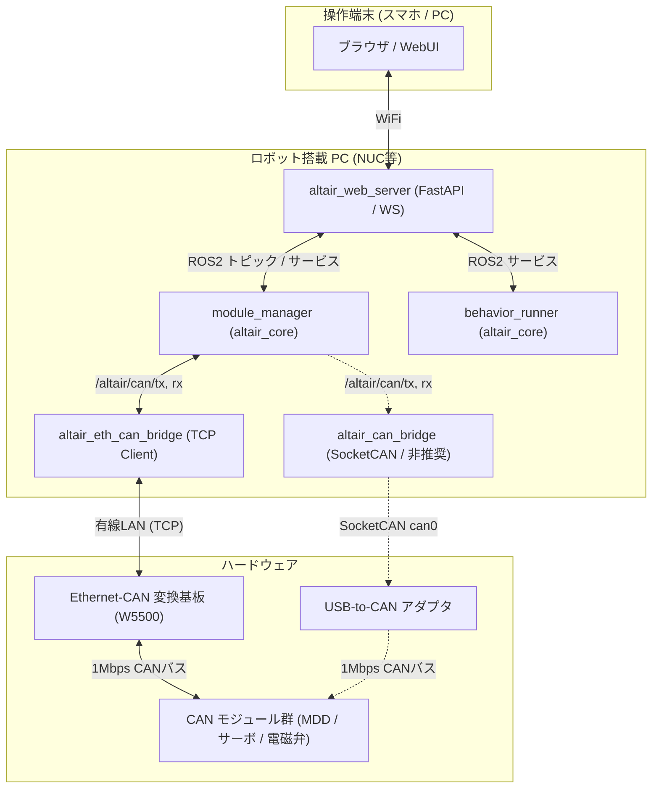

# Altair Framework (altair_framework)

CANバス（1 Mbps）で統一されたアクチュエータ制御モジュール群「Altair Module System」を、ROS2およびブラウザ（PC/スマホ）からシームレスに一括制御・管理するための統合ROS2パッケージです。

ロボット側のプログラムを完全に固定したまま、操縦者PC側でモジュール構成の動的変更やプロファイルの瞬時切り替え、PS5コントローラー連携、およびPython/Blocklyによる自律動作プログラムの動的起動とリアルタイムデバッグをサポートします。



---

## ディレクトリとドキュメントの配置

本リポジトリは、以下のマルチパッケージ構造で構成されています。詳細なドキュメントは docs/ ディレクトリをご参照ください。

```text
altair_framework/
├── README.md
├── build.sh / colconビルド用スクリプト
├── run_standalone.sh / 単一PC運用 (スタンドアロン) の一括起動スクリプト (推奨)
├── run_nuc.sh / NUCロボット側の起動スクリプト (2台PC運用時)
├── run_operator.sh / 操縦PC側の起動スクリプト (2台PC運用時)
│
├── altair_interfaces/ / カスタムメッセージとサービス定義
├── altair_eth_can_bridge/ / Ethernet-CAN (TCP / Analyzer Mode) ブリッジ (推奨)
├── altair_can_bridge/ / SocketCAN (USB slcan) ブリッジ (非推奨)
├── altair_core/ / システム制御と自律動作プログラムランナー
├── altair_web_server/ / FastAPIサーバーとWebUI
├── user_behaviors/ / 自律動作プログラムの配置場所
└── docs/ / 詳細ドキュメント群
```

---

## 前提条件と導入手順

本パッケージは、Ubuntu 22.04 + ROS2 Humble 環境での動作を確認しています。

### 依存パッケージのインストール
物理CANフレームをROS2上で扱うための標準パッケージ can_msgs / ビルドツールをインストールします。
```bash
sudo apt update
sudo apt install ros-humble-can-msgs python3-colcon-common-extensions
```

### Python依存ライブラリのインストール
FastAPIサーバーの稼働に必要なライブラリをインストールします。
```bash
pip install fastapi uvicorn websockets
```

### リポジトリのビルド
ワークスペースのトップでビルドスクリプトを実行します。
```bash
# 実行権限の付与
chmod +x build.sh run_standalone.sh run_nuc.sh run_operator.sh
chmod +x altair_can_bridge/scripts/setup_slcan.sh

# ビルドの実行
./build.sh

# キャッシュをクリーンして再ビルド
./build.sh --clean
```

別PCやUbuntu間でワークスペースを移動した直後は、古いCMakeキャッシュとの不整合を避けるため ./build.sh --clean を推奨します。

---

## 起動と運用コマンド

ロボットの運用形態（PC 1台運用または 2台運用）および通信ハードウェア（Ethernet-CAN または USB-to-CAN）に応じて起動方法を選択できます。

### PC 1台運用（推奨：ロボット搭載PCのみで全ノードを実行）
制御ループと通信をロボット内部で完結させるため、ロボコン会場での無線トラブルに最も強い構成です。


```bash
# Ethernet-CAN を使用する場合 (推奨 / デフォルト: 192.168.2.123:5000)
./run_standalone.sh

# 従来の USB-to-CAN を使用する場合 (非推奨)
./run_standalone.sh --usb
```
起動後、同一WiFiネットワーク内のPCやスマートフォンのブラウザから、以下のURLにアクセスします。
* URL: `http://<ロボットPCのIPアドレス>:8000/`

### PC 2台運用（ロボット側 NUC + 操縦者 PC）


* ロボット側 NUC
  ```bash
  # Ethernet-CAN (推奨 / デフォルト)
  ./run_nuc.sh

  # 従来の USB-to-CAN (非推奨)
  ./run_nuc.sh --usb
  ```
* 操縦者 PC
  ```bash
  ./run_operator.sh
  ```
  起動後、ブラウザから `http://localhost:8000/` または `http://<NUCのIPアドレス>:8000/` にアクセスします。

---

## WebUIの機能

* Dashboard: drive_mdd / arm_servo / valve_controller のモジュールカードが動的に生成され、スライダーやトグルボタンで低遅延の直接操作が可能です。リミットスイッチの状態やエンコーダ実測データもリアルタイムで描画します。
* Profiles: `profiles/hoge.json` などのモジュール構成をワンクリックで切り替えます。JSONファイルとしてローカルにエクスポート / インポートが可能です。
* Controller: スマートフォンやPCにBluetooth接続されたPS5コントローラーなどを自動検出し、アナログ軸やボタンへの割り当てを設定します。
* **Programs**: `user_behaviors/` ディレクトリ内の任意の Python スクリプトを WebUI から動的に選択・起動・停止できます。新規作成したプログラムファイルはディレクトリに追加するだけで自動検出され、ドロップダウンメニューに表示されます。スクリプト内の `print()` やエラー出力もリアルタイムでストリーミングされます。
* Automation: Google Blockly を用いて、ブラウザ上でブロックを組み合わせて自動化マクロを作成して実行します。差動二輪やメカナムやオムニなどのロボット運動学制御もサポートしています。

---

## AIを用いた動作プログラムの自動作成

本パッケージでは、AIに動作プログラムを記述させるための専用プロンプト仕様書を用意しています。

* **[Wiki: 動作プログラム作成ガイド](https://github.com/Altairu/altair_framework/wiki/Behavior-Programming-Guide)** の内容をコピーします。
* 使用するAIチャットの入力欄に貼り付けます。
* 同ガイドの最下部にあるテンプレートに、動かしたいシナリオを追記してAIに送信します。たとえばスイッチが押されたらアームを下ろして吸引するなどの指示を書きます。
* AIが出力したPythonコードを `user_behaviors/` フォルダ内に **任意の名前** (`*.py`) で保存します。ファイルは自動的に検出されドロップダウンメニューに表示され、サーバー再起動なしで即座に実行できます。

---

## ライセンス

本プロジェクトは MIT License の元で公開されています。詳細は [LICENSE](LICENSE) ファイルを参照してください。

---