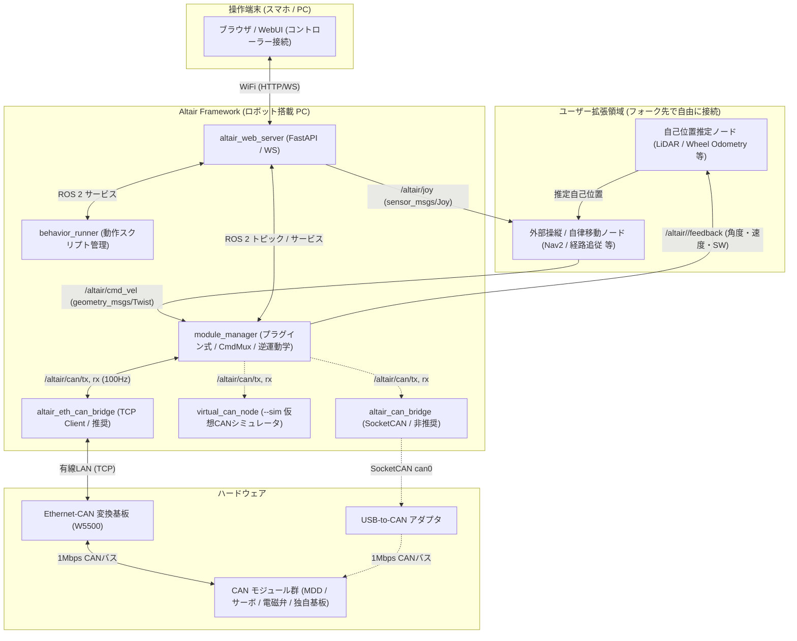

# Altair Framework (altair_framework)

CANバス（1 Mbps）で統一されたアクチュエータ制御モジュール群「Altair Module System」を、ROS 2 およびブラウザ（PC/スマホ）からシームレスに一括制御・管理するための統合 ROS 2 パッケージです。

**「モジュールマイコンとの通信の簡便化」** と **「フォークして自由に改造・拡張しやすい疎結合設計」** を基本方針としており、ロボット側の基本通信層を固定したまま、外部の自己位置推定ノードや自律移動ノードの接続、新規 CAN モジュールのプラグイン追加、Python / Blockly による動作プログラム開発を容易に行えます。



---

## ディレクトリとドキュメントの配置

本リポジトリは、フォーク後の改造箇所が明確になるよう以下の構成に整理されています。詳細な仕様書は `docs/` ディレクトリをご参照ください。

```text
altair_framework/
├── README.md
├── build.sh                     # colcon ビルド用スクリプト
├── run_standalone.sh            # 単一PC運用 (スタンドアロン / --sim 対応) 一括起動スクリプト (推奨)
├── run_nuc.sh                   # NUCロボット側の起動スクリプト (2台PC運用時 / --sim 対応)
├── run_operator.sh              # 操縦PC側の起動スクリプト (2台PC運用時)
│
├── altair_interfaces/           # カスタムメッセージ (.msg) とサービス (.srv) 定義
├── altair_eth_can_bridge/       # Ethernet-CAN (TCP / Analyzer Mode) ブリッジ (推奨)
├── altair_can_bridge/           # SocketCAN (USB slcan) ブリッジ (非推奨)
├── altair_core/                 # システム制御・プラグイン・運動学・シミュレータ
│   ├── config/
│   │   └── modules_config.json  # モジュール構成・足回り運動学の設定ファイル (単一正本)
│   └── altair_core/
│       ├── module_manager.py    # CAN<->ROS 2 変換・/cmd_vel 逆運動学・優先度調停ノード
│       ├── kinematics.py        # 3輪/4輪オムニ・メカナム・差動2輪の逆運動学計算器
│       ├── base_behavior.py     # 動作プログラム用ベースクラス (AltairBehavior)
│       ├── behavior_runner.py   # 動作プログラム動的起動・ログ配信ランナー
│       ├── virtual_can_node.py  # 実機レス開発用の仮想CANシミュレータ (--sim)
│       ├── paths.py             # 環境非依存のワークスペースパス解決ヘルパー
│       └── modules/             # 【拡張ポイント】CANモジュールプラグイン群
│           ├── base_module.py   # プラグイン基底クラス & @register_module デコレータ
│           ├── mdd_module.py    # 4ch DCモータドライバ (MDD) プラグイン
│           ├── servo_module.py  # 6ch サーボモータプラグイン
│           └── solenoid_module.py # 12ch 電磁弁プラグイン
├── altair_web_server/           # FastAPI サーバーと WebUI フロントエンド
├── profiles/                    # モジュール構成プロファイル保存ディレクトリ (*.json)
├── user_behaviors/              # 【拡張ポイント】自律動作プログラム (*.py) の配置場所
└── docs/                        # 詳細技術ドキュメント群
```

---

## 前提条件と導入手順

本パッケージは、Ubuntu 22.04 + ROS 2 Humble 環境での動作を確認しています。

### 依存パッケージのインストール
```bash
sudo apt update
sudo apt install ros-humble-can-msgs python3-colcon-common-extensions
pip install fastapi uvicorn websockets
```

### リポジトリのビルド
ワークスペースのトップでビルドスクリプトを実行します。
```bash
chmod +x build.sh run_standalone.sh run_nuc.sh run_operator.sh
chmod +x altair_can_bridge/scripts/setup_slcan.sh

# ビルドの実行
./build.sh

# 別PCへクローン・移動した直後など、キャッシュをクリーンして再ビルドする場合
./build.sh --clean
```

---

## 起動と運用コマンド

### 1. 実機レス・シミュレータモード（フォーク直後の動作確認・開発に推奨）
手元に Ethernet-CAN 基板や実機ロボットがなくても、仮想 CAN マイコンと足回り運動学エミュレータが応答するシミュレータモードで全機能（WebUI・自律プログラム・`/cmd_vel`・RViz2）をテストできます。
```bash
./run_standalone.sh --sim
```
* **Web UI (http://localhost:8000/) の「Simulator」メニュー**:
  * **2D ミニマップ**: オドメトリからロボットの現在位置 `(x, y, θ)` と走行軌跡をリアルタイム描画。
  * **リミットスイッチ インジェクタ**: クリックで各 MDD の SW1〜SW4 を ON/OFF トグル（Behavior の条件待ち試験に便利）。
  * **電磁弁・サーボ状態モニタ**: 12ch 電磁弁の ON/OFF と 6ch サーボの角度ゲージを可視化。
* **ROS 2 / RViz2 3D 可視化**:
  * シミュレータモード起動中は `/odom` (`nav_msgs/msg/Odometry`) および `/tf` (`odom` ➔ `base_link`) が自動配信されます。
  * 別ターミナルで `./run_rviz.sh` を実行するだけで、RViz2 上で機体の 3D オドメトリと走行軌跡を目視確認できます。
  ```bash
  ./run_rviz.sh
  ```

### 2. PC 1台運用（推奨：ロボット搭載PCのみで全ノードを実行）
制御ループと通信をロボット内部で完結させるため、ロボコン会場での無線トラブルに最も強い構成です。
```bash
# Ethernet-CAN を使用する場合 (推奨 / デフォルト: 192.168.2.123:5000)
./run_standalone.sh

# 従来の USB-to-CAN を使用する場合 (非推奨)
./run_standalone.sh --usb
```
起動後、同一ネットワーク内のPCやスマートフォンのブラウザから `http://<ロボットPCのIPアドレス>:8000/` にアクセスします。

### 3. PC 2台運用（ロボット側 NUC + 操縦者 PC）
* **ロボット側 NUC**
  ```bash
  ./run_nuc.sh          # Ethernet-CAN (推奨)
  ./run_nuc.sh --sim    # 仮想CANシミュレータ
  ./run_nuc.sh --usb    # USB-to-CAN
  ```
* **操縦者 PC**
  ```bash
  ./run_operator.sh
  ```

---

## 📡 通信リスト（ROS 2 トピック・サービス・CAN ID 一覧）

フォークして外部ノード（自己位置推定・自律移動・独自UIなど）を接続する際は、以下のインターフェースを使用します。

### 1. ROS 2 トピック一覧

| トピック名 | メッセージ型 | 方向 / 周期 | 説明・用途 |
|---|---|---|---|
| `/altair/cmd_vel`<br>（または `/cmd_vel`） | `geometry_msgs/msg/Twist` | 外部 ➔ `module_manager`<br>(随時 / 推奨 20〜100Hz) | **足回り速度指令（外部操縦・自律移動用）**。<br>`modules_config.json` の `chassis` 設定に基づき、4輪の目標 `rps` へ逆運動学変換して送信します。<br>デフォルト（`coord_frame: "ros"`）では `linear.x` = 前進 [m/s]、`linear.y` = 左移動 [m/s]、`angular.z` = 左旋回 [rad/s]。<br>※ 0.5秒間受信が途絶えると安全のため自動停止します。 |
| `/altair/emergency_stop` | `std_msgs/msg/Bool` | 外部 ➔ `module_manager`<br>(随時) | **緊急停止トピック**。`data: true` を送ると即座に全 MDD モータ出力を 0 に固定し、制御状態を解除します。 |
| `/altair/joy` | `sensor_msgs/msg/Joy` | `web_server` ➔ 外部 / Behavior<br>(操作時リアルタイム) | **標準ゲームパッド入力**。WebUI に接続されたコントローラーの軸 (`axes: float[]`) とボタン (`buttons: int32[]`) を ROS 2 標準形式で配信します。外部操縦ノードからそのまま購読可能です。 |
| `/altair/gamepad/state` | `std_msgs/msg/String` | `web_server` ➔ Behavior | 後方互換用の JSON 文字列形式ゲームパッド状態 (`{"axes": [...], "buttons": [...]}`)。 |
| `/altair/<mdd_name>/cmd` | `altair_interfaces/msg/MddCommand` | 外部 / Behavior ➔ `module_manager` | 指定 MDD モジュールの4ch目標値 (`float32[4] targets`) を直接指定します（速度: `rps`, 角度: `deg`, 位置: `mm`）。`/cmd_vel` より優先されます。 |
| `/altair/<mdd_name>/feedback` | `altair_interfaces/msg/MddFeedback` | `module_manager` ➔ 外部 / Behavior<br>(100Hz / 10ms周期) | **MDD フィードバック（自己位置推定ノード等の入力用）**。<br>・`bool[4] limit_switches`: リミットスイッチ1〜4の状態<br>・`float32[4] angles`: エンコーダ現在角度 [deg]<br>・`float32[4] speeds`: エンコーダ現在速度 [rps]<br>・`uint8 error_code`: エラーフラグ<br>・`uint8 system_status`: `0`=Setup待機, `1`=制御実行中 |
| `/altair/<servo_name>/cmd` | `altair_interfaces/msg/ServoCommand` | 外部 / Behavior ➔ `module_manager` | 6ch サーボ目標角度 (`uint8[6] angles`, `0`〜`180`度)。 |
| `/altair/<solenoid_name>/cmd` | `altair_interfaces/msg/SolenoidCommand` | 外部 / Behavior ➔ `module_manager` | 12ch 電磁弁 ON/OFF 状態 (`bool[12] valves`)。 |
| `/altair/can/tx` | `can_msgs/msg/Frame` | `module_manager` ➔ CANブリッジ<br>(100Hz) | PC から CAN バスへ送出する生 CAN フレーム。 |
| `/altair/can/rx` | `can_msgs/msg/Frame` | CANブリッジ ➔ `module_manager`<br>(100Hz) | CAN バスから受信した生 CAN フレーム。 |
| `/altair/can/status` | `altair_interfaces/msg/CanStatus` | CANブリッジ ➔ `web_server`<br>(1Hz) | CAN ブリッジの接続状態・ポート名・ビットレート・エラー情報。 |
| `/altair/behavior/status` | `std_msgs/msg/String` | `behavior_runner` ➔ `web_server`<br>(1Hz) | 動作スクリプトの実行状態 (`IDLE`, `RUNNING (<name>)`, `STOPPING`, `ERROR`)。 |
| `/altair/behavior/log` | `std_msgs/msg/String` | `behavior_runner` ➔ `web_server` | 動作スクリプト内の `print()` および標準エラー出力のリアルタイムストリーム。 |

### 2. ROS 2 サービス一覧

| サービス名 | サービス型 | 提供ノード | 説明・用途 |
|---|---|---|---|
| `/altair/start_control` | `altair_interfaces/srv/TriggerControl` | `module_manager` | 全 MDD モジュールへ PID ゲイン・車輪径・制御モード設定フレームを一括送信し、システムを「制御実行状態 (`is_running=True`)」へ遷移させます。 |
| `/altair/reload_config` | `std_srvs/srv/Trigger` | `module_manager` | `modules_config.json` を再読み込みし、モジュールプラグインと動的トピックを再構築します。 |
| `/altair/behavior/start` | `altair_interfaces/srv/StartBehavior` | `behavior_runner` | `user_behaviors/` 内の指定 Python スクリプト (`behavior_name`) をサブプロセスとして起動します。 |
| `/altair/behavior/stop` | `std_srvs/srv/Trigger` | `behavior_runner` | 現在実行中の動作スクリプトへ `SIGINT` を送り安全に停止します。 |
| `/altair/eth_can/connect` | `altair_interfaces/srv/ConnectEthCan` | `eth_can_bridge` / `virtual_can` | Ethernet-CAN 基板の IP アドレス・ポート番号を指定して再接続します。 |
| `/altair/can/connect` | `altair_interfaces/srv/ConnectCan` | `can_bridge` / `virtual_can` | USB-to-CAN ポートへの接続・再接続を行います。 |
| `/altair/can/get_ports` | `altair_interfaces/srv/GetAvailablePorts` | `can_bridge` / `virtual_can` | 利用可能なシリアルポート一覧を取得します。 |

### 3. CAN バス ID マップ（1 Mbps）

| CAN ID (Hex) | 方向 | モジュール | 内容 | DLC | 周期 |
|---|---|---|---|---|---|
| `0x100` *(BaseID)* | PC ➔ MCU | **Servo** | 6ch 角度指令 (`uint8` × 6ch, 0〜180度) | 6 B | 10 ms |
| `0x200`〜`0x203` *(BaseID+0..3)* | PC ➔ MCU | **MDD** | Motor 1〜4 PIDゲイン(`×1000`) ＆ 車輪径[mm]×方向符号 (`int16` × 4) | 8 B | 制御開始時 |
| `0x210` *(BaseID+0x10)* | PC ➔ MCU | **MDD** | 4ch 制御モード設定 (`uint8` × 4: `0`=速度, `1`=角度, `2`=位置) | 4 B | 制御開始時 |
| `0x220` *(BaseID+0x20)* | PC ➔ MCU | **MDD** | 4ch 目標値指令 (`int16` × 4, 物理値 `×10`) | 8 B | 10 ms |
| `0x230` *(BaseID+0x30)* | MCU ➔ PC | **MDD** | ステータス返信 (Limit SW1〜4, ErrorCode, SystemStatus) | 8 B | 10 ms |
| `0x240` *(BaseID+0x40)* | MCU ➔ PC | **MDD** | 4ch エンコーダ現在角度 (`int16` × 4, `0.1 deg` 単位) | 8 B | 10 ms |
| `0x250` *(BaseID+0x50)* | MCU ➔ PC | **MDD** | 4ch エンコーダ現在速度 (`int16` × 4, `0.01 rps` 単位) | 8 B | 10 ms |
| `0x300` *(BaseID)* | PC ➔ MCU | **Solenoid** | 12ch 電磁弁 ON/OFF ビットマップ (`uint16` リトルエンディアン) | 2 B | 10 ms |

---

## 🛠️ フォーク後の改造・カスタマイズガイド（いじり方）

### 1. 自己位置推定や外部操縦ノードを自作して繋ぐ
本フレームワークは**「自己位置推定（Odometry / SLAM）はシステム内部に持たず、ユーザーが外部ノードとして自由に構成する」**方針をとっています。

* **ホイールエンコーダ値を外部の自己位置推定ノードで使う場合**:
  `/altair/<mdd_name>/feedback` (`altair_interfaces/msg/MddFeedback`) をサブスクライブすると、100Hz で4輪の角度 (`msg.angles` [deg]) と回転速度 (`msg.speeds` [rps])、リミットスイッチ (`msg.limit_switches`) を取得できます。
* **外部の自律移動・操縦ノードから足回りを動かす場合**:
  [`altair_core/config/modules_config.json`](file:///home/altair/altair_framework/altair_core/config/modules_config.json) の `"chassis"` セクションで足回りタイプ（`3_OMNI`, `4_OMNI`, `4_MECANUM`, `2_DIFF`）を設定しておけば、外部ノードから `/altair/cmd_vel`（または `/cmd_vel`）に `geometry_msgs/msg/Twist` をパブリッシュするだけで足回りを制御できます。

```bash
# ターミナルから /altair/cmd_vel で前進 (0.5 m/s) させるテストコマンド例
ros2 topic pub /altair/cmd_vel geometry_msgs/msg/Twist "{linear: {x: 0.5, y: 0.0, z: 0.0}, angular: {x: 0.0, y: 0.0, z: 0.0}}" -r 20
```

### 2. 新しい種類の CAN モジュールマイコンを追加する（プラグイン方式）
独自の CAN マイコン基板（例：ToF距離センサ基板、新型ブラシレスMD、LED基板など）を追加する際、`module_manager.py` 本体を書き換える必要はありません。
[`altair_core/altair_core/modules/`](file:///home/altair/altair_framework/altair_core/altair_core/modules/) ディレクトリに **`<名前>_module.py` を1ファイル追加するだけ**で自動認識されます。

```python
# 例: altair_core/altair_core/modules/tof_sensor_module.py
import struct
from std_msgs.msg import Float32
from can_msgs.msg import Frame
from altair_core.modules.base_module import BaseModulePlugin, register_module

class TofClient:
    """user_behaviors から self.get_module() で取得できるクライアント"""
    def __init__(self, node, name: str):
        self.distance_mm = 0.0
        node.create_subscription(
            Float32, f"/altair/{name}/distance",
            lambda msg: setattr(self, "distance_mm", msg.data), 10,
            callback_group=node.callback_group
        )

@register_module("tof")  # ← modules_config.json の "type": "tof" と対応
class TofModulePlugin(BaseModulePlugin):
    def setup_ros_interfaces(self):
        self.dist_pub = self.create_module_publisher(Float32, f"/altair/{self.name}/distance")

    def handle_can_rx(self, frame: Frame) -> bool:
        if frame.id == self.base_id and frame.dlc >= 2:
            (dist_raw,) = struct.unpack("<H", bytes(frame.data[:2]))
            msg = Float32()
            msg.data = float(dist_raw)
            self.dist_pub.publish(msg)
            return True
        return False

    @classmethod
    def create_behavior_client(cls, behavior_node, name: str, module_config: dict):
        return TofClient(behavior_node, name)
```

### 3. 自律動作プログラム（`user_behaviors/`）を追加・改造する
[`user_behaviors/template_behavior.py`](file:///home/altair/altair_framework/user_behaviors/template_behavior.py) をコピーして `user_behaviors/` 内に新しい `.py` ファイルを作成すると、WebUI の **Programs** タブに自動表示されます。
[`AltairBehavior`](file:///home/altair/altair_framework/altair_core/altair_core/base_behavior.py) には、モジュール操作だけでなく足回り速度指定やノンブロッキングなステートマシン記述用のヘルパーが用意されています。

```python
class MyBehavior(AltairBehavior):
    def on_init(self):
        self.mdd = self.get_module("MDD1")
        self.set_state("APPROACH")

    def loop(self):
        fb = self.mdd.get_feedback()

        if self.state == "APPROACH":
            # 足回り運動学ヘルパーで前進 (vx=0 mm/s, vy=400 mm/s, omega=0 rad/s)
            self.set_chassis_velocity(0.0, 400.0, 0.0)
            # リミットスイッチ1が押されるか、3秒経過したら次へ
            if fb.limit_switches[0] or self.elapsed_in_state() >= 3.0:
                self.stop_chassis()
                self.set_state("WAIT_AND_FINISH")

        elif self.state == "WAIT_AND_FINISH":
            if self.elapsed_in_state() >= 1.0:
                self.set_state("DONE")
```

---

## WebUI の機能

* **Dashboard**: `mdd` / `servo` / `solenoid` のモジュールカードが動的に生成され、スライダーやトグルボタンで低遅延の直接操作が可能です。リミットスイッチの状態やエンコーダ実測データもリアルタイムで描画します。
* **Profiles**: `profiles/*.json` のモジュール構成をワンクリックで切り替えます。JSONファイルとしてローカルにエクスポート / インポートが可能です。
* **Controller**: スマートフォンやPCに接続されたゲームコントローラー（PS5等）を自動検出し、`/altair/joy` (`sensor_msgs/msg/Joy`) および `/altair/gamepad/state` へリアルタイム配信します。
* **Programs**: `user_behaviors/` ディレクトリ内の任意の Python スクリプトを WebUI から動的に選択・起動・停止できます。スクリプト内の `print()` やエラー出力もリアルタイムでストリーミングされます。
* **Automation**: Google Blockly を用いて、ブラウザ上でブロックを組み合わせて自動化マクロを作成して実行します。差動二輪・メカナム・3輪/4輪オムニのロボット運動学制御もサポートしています。

---

## ライセンス

本プロジェクトは MIT License の元で公開されています。詳細は [LICENSE](file:///home/altair/altair_framework/LICENSE) ファイルを参照してください。
