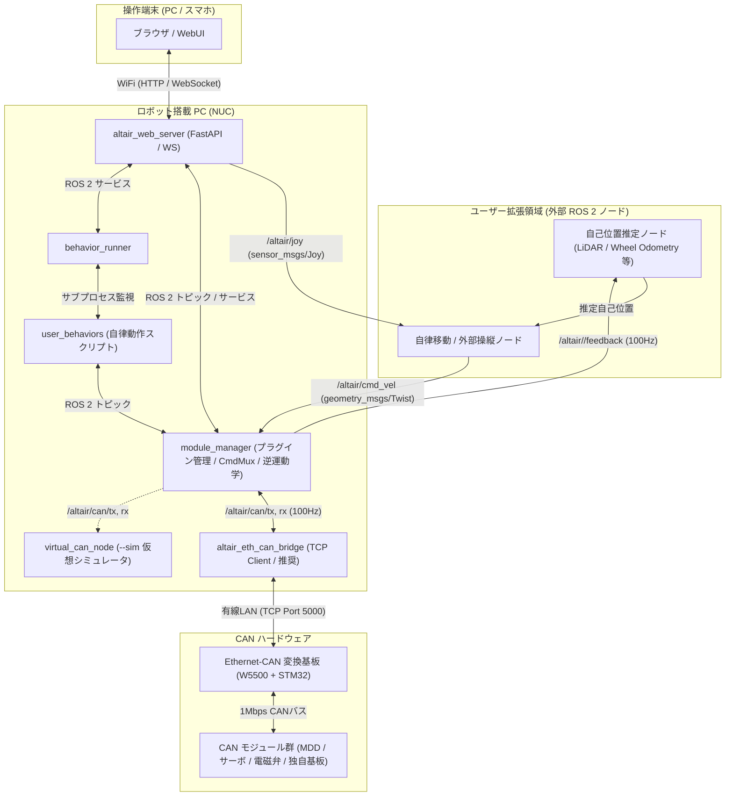
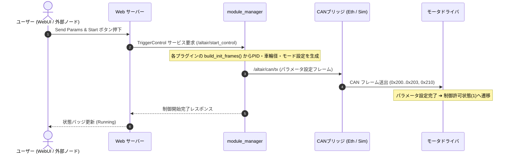

# Altair Framework システム設計書 (architecture.md)

本ドキュメントは、CANバス（1 Mbps）で統一されたアクチュエータ制御モジュール群 Altair Module System を一括制御する ROS 2 パッケージ `altair_framework` の全体アーキテクチャ、通信データフロー、プラグイン拡張機構、および外部ノード連携モデルについて詳細に解説する仕様設計書です。

---

## 全体アーキテクチャ概要

本システムは、**「モジュールマイコンとの通信の簡便化」** を中核とし、以下の3層に分離した疎結合設計を採用しています。
また、**自己位置推定（Odometry / SLAM）は本フレームワークの内部には持たず、ユーザーが外部 ROS 2 ノードとして自由に接続できる設計**としています。

1. **外部拡張・上位アプリケーション層**: ユーザーが用意する自己位置推定ノード、外部操縦・自律移動ノード、および `user_behaviors/` スクリプト。
2. **コア制御・プラグイン管理層 (`altair_core`, `altair_web_server`)**: `modules_config.json` に基づく動的トピック生成、`/altair/cmd_vel` の逆運動学変換、制御権限の調停 (Cmd Mux)、WebUI 配信。
3. **物理通信ブリッジ層 (`altair_eth_can_bridge` / `virtual_can_node` / `altair_can_bridge`)**: `/altair/can/tx, rx` と物理 CAN バス（または仮想シミュレータ）の中継。

---

## 運用形態とブリッジ層の切り替え仕様

起動スクリプトの引数によって、運用環境やハードウェア有無に応じた3つのモードをシームレスに切り替えられます。

* **Ethernet-CAN モード（推奨 / デフォルト: `./run_standalone.sh`）**
  * `altair_eth_can_bridge` を使用。TCP ソケット（初期値: `192.168.2.123:5000`）で Ethernet-CAN 変換基板と直結通信します。
* **仮想 CAN シミュレータモード（実機レス開発用: `./run_standalone.sh --sim`）**
  * `virtual_can_node` を使用。`/altair/can/tx` に送出された MDD パラメータや速度・角度目標値に対して仮想マイコンとして100Hzで応答（角度積分・速度追従）し、`/altair/can/rx` へフィードバックを返します。フォーク直後の開発や実機がない環境でのデバッグに最適です。
* **USB-to-CAN モード（レガシー互換: `./run_standalone.sh --usb`）**
  * `altair_can_bridge`（Linux SocketCAN `slcan`）を使用します。

---

## 制御権限の調停（Cmd Mux）と安全機構

外部ノード・WebUI・動作スクリプトが同時に足回りを操作した際の競合を防ぐため、`module_manager` 内に以下の優先度調停（Cmd Mux）とウォッチドッグを備えています。

1. **優先度0（最優先）：緊急停止 (`/altair/emergency_stop`, `std_msgs/msg/Bool`)**
   * `True` を受信すると即座に `is_running = False` とし、全 MDD モータへ `0.0` 指令を送り続けます。
2. **優先度1：直接モジュール指令 (`/altair/<mdd_name>/cmd`, `MddCommand`)**
   * WebUI のスライダー操作や `user_behaviors` からの直接指令です。直近 `0.5秒` 以内に直接指令が行われた場合、外部の `/cmd_vel` 指令よりも優先されます。
3. **優先度2：外部速度指令 (`/altair/cmd_vel` または `/cmd_vel`, `geometry_msgs/msg/Twist`)**
   * 外部の操縦ノードや経路追従ノードからの速度指令です。`ChassisKinematics` により各輪の目標 `rps` に変換されます。
   * **通信途絶ウォッチドッグ**: `/cmd_vel` による走行中、`cmd_vel_timeout_sec`（デフォルト `0.5秒`）以上次のメッセージが来ない場合は自動的に4輪を `0.0 rps` に停止させ、暴走を防止します。

---

## モジュールプラグインアーキテクチャ (`altair_core/modules/`)

新しい CAN モジュール基板を追加する際、`module_manager.py` や `base_behavior.py` を編集する必要はありません。
`altair_core/altair_core/modules/` 配下のすべてのモジュールファイルが起動時に自動スキャンされ、`@register_module("<type>")` デコレータによって登録されます。

* `BaseModulePlugin` の主なフックメソッド:
  * `setup_ros_interfaces()`: モジュール固有の ROS 2 Publisher / Subscriber を生成。
  * `build_init_frames()`: `/altair/start_control` 実行時に送信する初期化 CAN フレーム群を返却。
  * `build_periodic_tx_frames(is_running)`: 100Hz タイマーで周期送信する CAN フレーム群を返却。
  * `handle_can_rx(frame)`: `/altair/can/rx` 受信時に自モジュールの CAN ID を判定し、デコード・ROS 2 トピック配信を実行。
  * `create_behavior_client(behavior_node, name, module_config)`: `AltairBehavior.get_module(name)` が返す Python クライアントインスタンスを生成。

---

## 制御開始シーケンス

安全仕様として、MDD モータドライバは起動直後にパラメータ設定モード（Setup Mode）で待機します。WebUI から `Send Params & Start` ボタンを押す（または `/altair/start_control` サービスを呼ぶ）ことで、全パラメータが一括送出され、安全に 100Hz の制御ループへ移行します。

